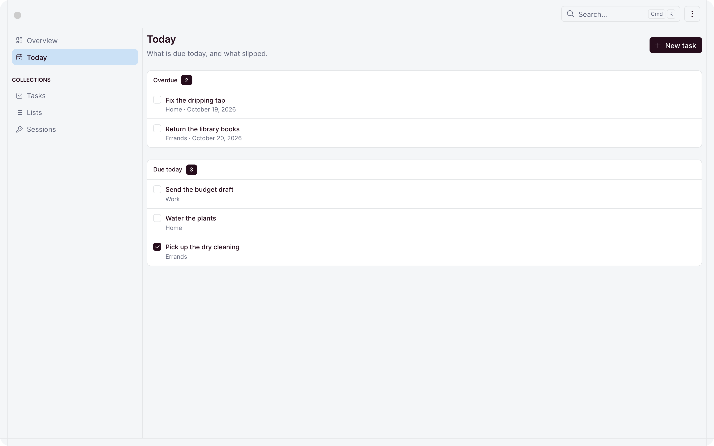

# Todo

Lists and tasks for every account, with a Today page and an AI assistant. Built on
[ohne](https://ohne.dev), free under the MIT licence.

<picture>
  <source media="(prefers-color-scheme: dark)" srcset="screenshots/readme/today-dark.png">
  
</picture>

## Live demo

Try it on [ohne.dev](https://ohne.dev/examples/todo). Sign in with one click as a member or an
admin, and you get your own copy of the app for 30 minutes, which nobody else sees. To try the
assistant, connect your own AI key from your ohne.dev account.

## What it shows

- **Collections.** `Lists` and `Tasks` in `collections/`, with color, date, select and
  record fields. See [collections](https://ohne.dev/docs/database/collections).
- **Access scopes.** `collections/_own.ts` keeps every account to its own lists and
  tasks, and lets a `todo.manage` capability past. See
  [who is asking](https://ohne.dev/docs/api/collections#who-is-asking) and
  [custom capabilities](https://ohne.dev/docs/auth/roles#custom-capabilities).
- **Sign-up.** `api/signup.post.ts` creates a member and signs them in. See
  [creating accounts](https://ohne.dev/docs/auth/authentication#creating-accounts).
- **A password rule.** `collections/Users.ts` extends the shipped `Users` collection
  with a minimum length, so every way of setting a password keeps it. See
  [adding fields to Users](https://ohne.dev/docs/auth/authentication#adding-fields-to-users).
- **A role.** `roles/member.ts`, the role sign-up grants. See
  [roles](https://ohne.dev/docs/auth/roles).
- **A dashboard page.** `dashboard/pages/today.ts`, linked in the sidebar by
  `ohne.config.ts`. See [pages](https://ohne.dev/docs/dashboard/pages) and
  [data](https://ohne.dev/docs/dashboard/data).
- **Tables and editors for free.** The `dashboard` key of each collection sets the columns and the
  form. See
  [the collection in the dashboard](https://ohne.dev/docs/database/collections#the-collection-in-the-dashboard).
- **An assistant.** `ohne.config.ts` stacks `ohnejs/ai`, lets it read lists and tasks, and gives
  it the rules of the app. `skills/` teaches it Plan my day, Capture, Reschedule overdue and Weekly
  review. Every write it proposes runs with your own session and waits for your approval, unless you
  turn on auto-accept on your account page for small edits like ticking off a task. See
  [the assistant](https://ohne.dev/docs/ai/assistant) and [skills](https://ohne.dev/docs/ai/skills).
- **Messages.** English and German in `messages/todo/`. See
  [messages](https://ohne.dev/docs/i18n/messages).
- **A seed.** `boot/_seed.ts`, run by `boot/seed.ts`. See
  [boot files](https://ohne.dev/docs/project/boot).
- **Tests.** `tests/` boots the API in the test process and checks each rule above
  over HTTP.

## Getting started

In a copy of this repository:

```sh
pnpm install
pnpm dev
```

Open `http://localhost:9000` and sign in:

| Account | Email               | Password                        | Sees                            |
| ------- | ------------------- | ------------------------------- | ------------------------------- |
| Member  | `demo@example.com`  | `ohne-demo`                     | their own lists and tasks       |
| Admin   | `admin@example.com` | printed by the first `pnpm dev` | every account's lists and tasks |

The assistant runs on Claude. Put your key in `.env` as `ANTHROPIC_API_KEY=...` and press Cmd+K
in the dashboard. Without a key, Cmd+K stays a search.

Once an account exists, anyone can sign up as a member:

```sh
curl http://localhost:9001/signup -H 'content-type: application/json' \
  -d '{ "email": "you@example.org", "password": "correct horse" }'
```

The seed fills an empty database only, and never under `NODE_ENV=production`. Delete
`.data/` to start over.

The checks:

```sh
pnpm typecheck
pnpm test
pnpm lint
pnpm format --check
```

## Upgrading

Bump `ohnejs` in `package.json` and follow the framework's
[release notes](https://github.com/ohnejs/ohnejs/releases). To pick up later changes to this
example, compare your copy with this repository.

## Deploy

Todo is a plain ohne app. Run `ohne serve api` and `ohne serve dashboard` as the
[deployment guide](https://ohne.dev/docs/production/deployment) describes.

Set `NODE_ENV=production`. The seed then stays out, and sign-up stays closed until an admin exists.
The first visit to the dashboard opens the install page, where you create that admin.

The app keeps its data in SQLite. For a bigger install, move to
[Postgres](https://ohne.dev/docs/database/engine#postgres).

## Licence and credits

MIT, see `LICENSE`. The seed holds no third-party assets.

## One owner per install

One install serves one group of accounts. A member sees only their own lists and tasks, and an
admin sees everyone's.
